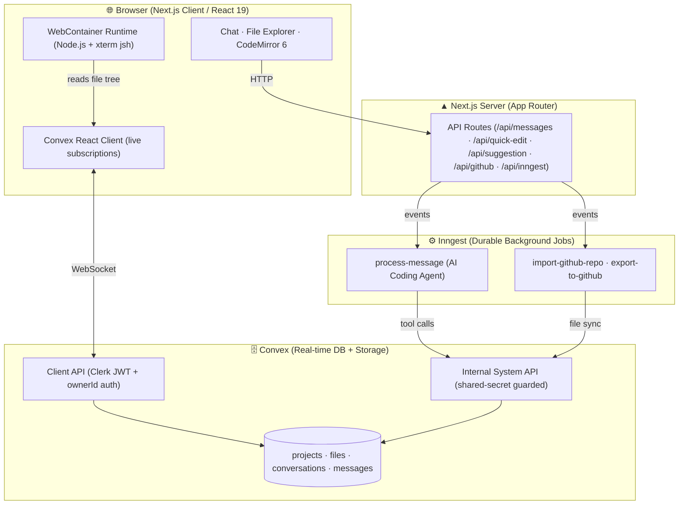

<div align="center">

# 🌐 BrowserIDE

### Prompt-to-app in your browser — an AI cloud IDE that writes, runs, and shares code.

Describe what you want to build. An autonomous AI agent scaffolds the files, a full Node.js runtime boots **inside your browser tab**, and you get a live preview in seconds — no local setup or server-side sandbox required.

</div>

---

## 📖 Project Description

**BrowserIDE** is a full-featured, AI-native development environment that runs entirely in the browser by combining three layers:

1. **Autonomous Coding Agent (Inngest + Groq):** Turns natural-language prompts into multi-file projects with real-time tool-call progress (`openai/gpt-oss-120b` for coding, `openai/gpt-oss-20b` for inline autocomplete, quick edits, and titles).
2. **Real-Time Filesystem (Convex):** Stores projects, file trees, binary assets, and conversations in a live database so agent edits stream into the editor and preview instantly.
3. **Browser-Native Runtime (WebContainers + xterm.js):** Boots Node.js client-side, installs dependencies, runs your dev server, and provides an interactive `jsh` shell.

### Key Features

- **Prompt-to-App Agent:** Creates, reads, updates, renames, and deletes project files autonomously with live tool-call step progress in chat.
- **Live In-Browser Preview & `jsh` Shell:** Runs `npm install` and your dev server inside the browser tab with both build logs and an interactive `jsh` terminal.
- **"Fix with AI" Auto-Debugger:** Captures recent WebContainer terminal errors and sends them straight to the AI agent to diagnose and patch.
- **Public Read-Only Share Links (`/share/[projectId]`):** Lets anyone inspect project code and boot the live preview without signing in.
- **AI-Assisted CodeMirror 6 Editor:** Syntax highlighting, tabs, breadcrumbs, inline ghost-text autocomplete, and selection-based Quick Edit (with optional Firecrawl URL context).
- **GitHub Import & Export:** Sync repositories via Clerk GitHub OAuth.

---

## 🏛️ Architecture

BrowserIDE is a **Next.js 16 (App Router)** application backed by **Convex** (real-time DB), **Inngest** (durable background jobs), **Clerk** (auth & GitHub OAuth), **Groq** (LLM inference), and **WebContainers** (in-browser Node.js runtime).



### Trust Boundaries
- **Client API (`convex/projects.ts`, `files.ts`, `conversations.ts`):** Every private handler verifies Clerk auth (`verifyAuth`) and project ownership (`project.ownerId === identity.subject`). Public `/share/[projectId]` queries (`getPublicProject`, `getPublicFiles`) are strictly read-only and gated on `project.isPublic === true`.
- **Internal API (`convex/system.ts`):** Called only by trusted server routes and Inngest jobs using `CLOUDAIIDE_CONVEX_INTERNAL_KEY`.

---

## 🚀 Setup

### Prerequisites
- **Node.js 20+** and **npm**
- **Chromium-based browser** (Chrome, Edge, or Brave — required for WebContainers)
- Accounts for [Convex](https://convex.dev), [Clerk](https://dashboard.clerk.com), [Groq](https://console.groq.com/keys), and [Inngest](https://app.inngest.com) (optional for local dev)

### 1. Clone & Install

```bash
git clone https://github.com/Nikhil-X-codes/BrowserIDE.git
cd BrowserIDE
npm install
```

### 2. Configure Environment Variables

Copy `.env.example` to `.env.local` and fill in your values:

```bash
cp .env.example .env.local
```

| Variable | Required | Description |
| :--- | :--- | :--- |
| `NEXT_PUBLIC_CONVEX_URL` | Yes | Written automatically by `npx convex dev` (or your `.convex.cloud` URL in prod) |
| `CLOUDAIIDE_CONVEX_INTERNAL_KEY` | Yes | Random 64-char hex secret shared between Next.js and Convex |
| `NEXT_PUBLIC_CLERK_PUBLISHABLE_KEY` | Yes | From Clerk Dashboard → API Keys |
| `CLERK_SECRET_KEY` | Yes | From Clerk Dashboard → API Keys |
| `CLERK_JWT_ISSUER_DOMAIN` | Yes | Issuer URL from Clerk → JWT Templates → **Convex** template (`aud: "convex"`) |
| `GROQ_API_KEY` | Yes | From Groq Console |
| `INNGEST_EVENT_KEY` / `INNGEST_SIGNING_KEY` | Prod only | From Inngest Cloud (not needed for local `inngest-cli dev`) |
| `FIRECRAWL_API_KEY` | Optional | Enables URL scraping in Quick Edit and the AI agent |

Set the two server secrets in Convex as well:

```bash
npx convex env set CLOUDAIIDE_CONVEX_INTERNAL_KEY "<your-secret>"
npx convex env set CLERK_JWT_ISSUER_DOMAIN "<your-clerk-issuer-url>"
```

### 3. Run Locally (3 Terminals)

```bash
# Terminal 1 — Convex backend
npx convex dev

# Terminal 2 — Next.js dev server (http://localhost:3000)
npm run dev

# Terminal 3 — Inngest dev server (http://localhost:8288)
npx inngest-cli@latest dev -u http://localhost:3000/api/inngest
```

### 4. Verify

```bash
npm test          # Vitest unit tests
npm run lint      # ESLint
npm run build     # Next.js production build & type check
```

---

## 📄 License

Released under the **MIT License**.
